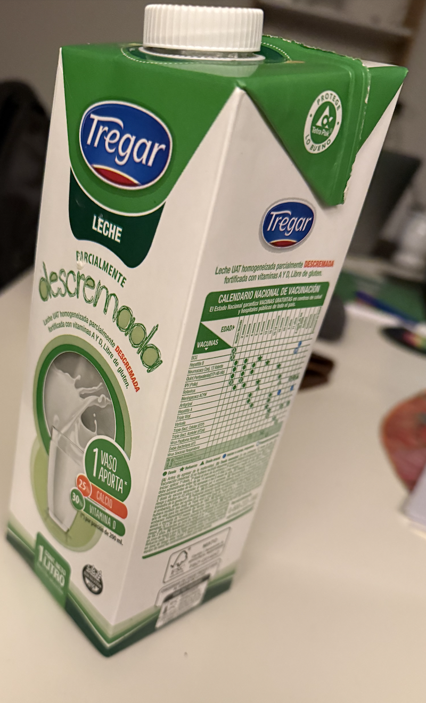

# Florence Demo 🚀



*Un script ligero y fácil de usar que emplea el modelo **Microsoft Florence-2-base-ft** para generar descripciones de imágenes.*

---

## Tabla de contenidos
- [Acerca de](#acerca-de)
- [Características](#características)
- [Demostración](#demostración)
- [Instalación](#instalación)
- [Uso](#uso)
- [Configuración](#configuración)
- [Contribuir](#contribuir)
- [Licencia](#licencia)
- [Agradecimientos](#agradecimientos)

---

## Acerca de

Este repositorio contiene una implementación mínima pero poderosa que utiliza el modelo **Florence‑2‑base‑ft** de Microsoft para generar leyendas (captions) a partir de imágenes. El script `yolo.py` (aunque conserva el nombre) carga el modelo y procesa una imagen dada, devolviendo una descripción en texto.

---

## Características

| ✅ | Característica |
|---|----------------|
| ✅ | Interfaz de línea de comandos simple |
| ✅ | Soporte para GPU cuando CUDA está disponible |
| ✅ | Generación de captions en español/inglés |
| ✅ | Dependencias reducidas (`transformers`, `torch`, `Pillow`) |
| ✅ | Salida rápida y fácil de integrar |

---

## Demostración

Ejemplo de ejecución:

```bash
python yolo.py --image yolo2.png
```

Salida esperada:

```
Descripción generada: "Un perro corriendo en un parque bajo un cielo azul."
```

---

## Instalación

```bash
# Clonar el repositorio
git clone https://github.com/yourusername/yolo.git
cd yolo

# Crear un entorno virtual (recomendado)
python3 -m venv .venv
source .venv/bin/activate

# Instalar dependencias
pip install -r requirements.txt  # crear este archivo si no existe
```

> **Nota**: El proyecto depende de `torch`, `transformers` y `Pillow`. Asegúrate de tener una versión compatible de CUDA para soporte GPU.

---

## Paso a paso para clonar y usar

1. **Clonar el repositorio**
   ```bash
   git clone https://github.com/yourusername/yolo.git
   cd yolo
   ```

2. **Crear y activar el entorno virtual**
   ```bash
   python3 -m venv .venv
   source .venv/bin/activate
   ```

3. **Instalar dependencias**
   ```bash
   pip install -r requirements.txt
   ```

4. **Hacer ejecutable el script de ayuda**
   ```bash
   chmod +x run.sh
   ```

5. **Ejecutar el demo**
   ```bash
   ./run.sh
   ```

---

---

## Clonar y ejecutar

```bash
chmod +x run.sh
./run.sh
```

Esto clonará el repositorio, instalará dependencias y ejecutará el demo.

---

## Uso

```bash
# Generar caption para una imagen
python yolo.py --image ruta/a/imagen.jpg
```

### Opciones de línea de comandos

| Argumento | Descripción | Predeterminado |
|-----------|-------------|----------------|
| `--image` | Ruta a la imagen a procesar | `./` |
| `--model` | Identificador del modelo de HuggingFace (por defecto Microsoft Florence) | `microsoft/Florence-2-base-ft` |
| `--device` | `cpu` o `cuda` (auto-detección) | `cuda` si está disponible |

---

## Configuración

Puedes sobrescribir los parámetros mediante un archivo `config.yaml`:

```yaml
model: microsoft/Florence-2-base-ft
device: cuda
```

Ejecuta con `--config config.yaml` para aplicar la configuración.

---

## Contribuir

¡Las contribuciones son bienvenidas! Sigue este flujo de trabajo:

1. Haz fork del repositorio.
2. Crea una rama de característica (`git checkout -b feat/tu-caracteristica`).
3. Realiza commits claros.
4. Abre un Pull Request.
5. Verifica que el linting (`flake8 .`) y las pruebas pasen.

---

## Licencia

Este proyecto está bajo la **Licencia MIT** – consulta el archivo [LICENSE](LICENSE) para más detalles.

---

## Agradecimientos

- **Microsoft** por el modelo Florence‑2. 
- La comunidad open‑source por `torch`, `transformers` y `Pillow`.

---
